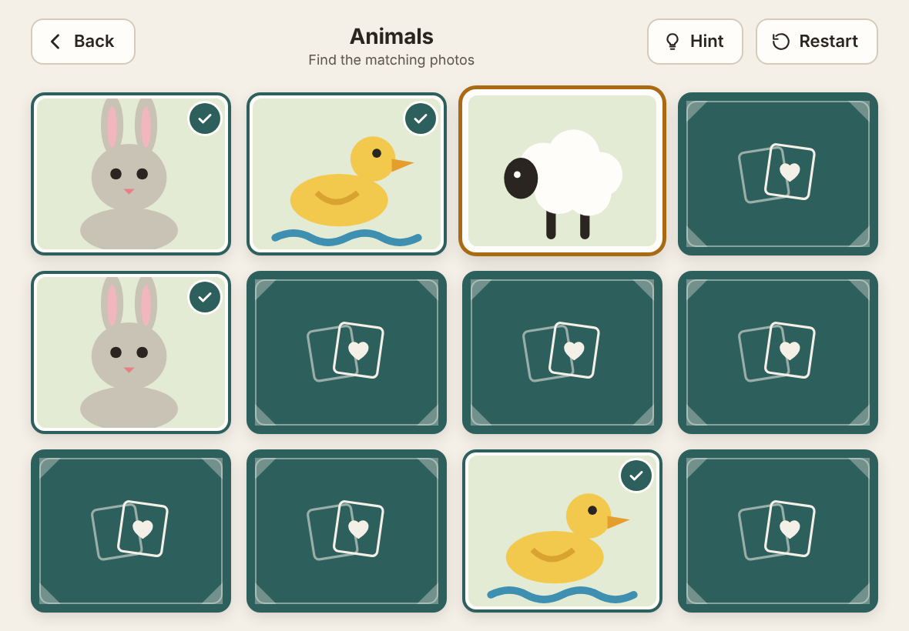

# Photo Pairs

A gentle "match the pairs" memory game that uses your family's own photos. Made for someone in hospital with an iPad: big cards, no timers, no scores, no way to lose, and it works with the Wi‑Fi off.

**Live app:** https://i-higgins.github.io/photo-memory-game/



- Plays with **your own photos** (added on the iPad from its photo library) or four built-in **starter picture** packs.
- 3, 6, 8 or 10 pairs. When a pair is found, the whole photo and its caption are shown large.
- **Works offline** after it's opened once. **Photos never leave the iPad**: no accounts, no uploads, no tracking, no ads.
- Free and open source (MIT). Plain HTML, CSS and JavaScript: no framework, no build step, no runtime dependencies.

## Installing on an iPad

1. Open the live link above in **Safari**.
2. Tap **Share** (the square with an arrow) → **Add to Home Screen** → **Add**.
3. **Open it once from the new Home Screen icon while you're on Wi‑Fi.** That downloads everything it needs. After that it works without internet.
4. **Add the photos inside the Home Screen app**, not in a Safari tab. The Home Screen app has its own storage, separate from Safari, so photos added in a Safari tab won't appear in the app.

To add photos: Home → **Family helper** → press and hold the circle for 2 seconds → **New album** → **Add photos**.

## Back up your albums

The photos are stored only inside the app on that iPad. **If the app is deleted from the Home Screen, or Safari's website data is cleared (Settings → Safari → Clear History and Website Data), the photos are gone.** iPadOS can also clear website storage when the iPad is very low on space (the app asks for "persistent" storage to make this less likely, and the helper area shows whether it got it).

So after adding photos: Family helper → **Back up an album** → **Save backup file**, and save the `.zip` to Files / iCloud Drive or email it to yourself. To put it back: Family helper → **Restore from a backup file**. Restoring merges: anything already on the iPad isn't duplicated.

The backup is a plain `.zip` holding the photos (JPEG) and a `photo-pairs.json` with the album names and captions.

## Tip: Guided Access

To keep the iPad in the game (no accidental swipes into other apps): **Settings → Accessibility → Guided Access → On**, set a passcode. Then open Photo Pairs and **triple‑click the top (or Home) button** to start Guided Access. Triple‑click again and enter the passcode to finish.

## Privacy

- Photos and captions are stored in the browser's IndexedDB on the device and are never sent anywhere.
- No accounts, analytics, tracking, ads or third-party requests. A Content Security Policy blocks requests to any other site.
- Backups only go where you choose to save or share the file.

## Run it locally

Requires Node 18+ (only for the dev server and tests; the app itself has no dependencies).

```bash
npm install
```

```bash
npm start
```

Then open http://localhost:8080. Service workers need `localhost` or HTTPS.

## Tests

```bash
npm test
```

Unit tests (`node --test`): dealing/shuffling, the match state machine (including "ignore the third tap"), save/resume, the grid table from the design spec, the zip format, and a check that every app file is precached by the service worker.

```bash
npx playwright install chromium webkit
```

```bash
npm run test:e2e
```

Playwright in Chromium and WebKit at an iPad viewport with touch: adding photos via the file input, captions, a full round, rapid triple-tapping, reload survival, offline play, and backup → delete → restore. Set `E2E_BROWSERS=chromium` to run one browser.

Other scripts: `npm run icons` regenerates the PNG icons from `assets/app/*.svg`; `node scripts/update-precache.mjs` refreshes the service-worker file list after adding app files; `node scripts/screenshots.mjs` screenshots every screen for comparing with `design/`.

## Releasing an update

Bump `VERSION` in `sw.js` and `APP_VERSION` in `js/version.js` (a test checks they match). Installed copies show "A new version is ready" and only refresh when someone taps it, never mid-game.

## Project layout

```
index.html, manifest.webmanifest, sw.js
css/tokens.css      design tokens (from design/tokens.css)
css/app.css         all styles
js/                 app (ES modules): game.js and layout.js are pure logic
assets/             card back, placeholder art, UI icons, starter packs
icons/              generated PNG app icons
design/             the design handoff (reference only, not deployed)
tests/              unit + Playwright tests
```

See [CONTRIBUTING.md](CONTRIBUTING.md) to add a starter pack.
